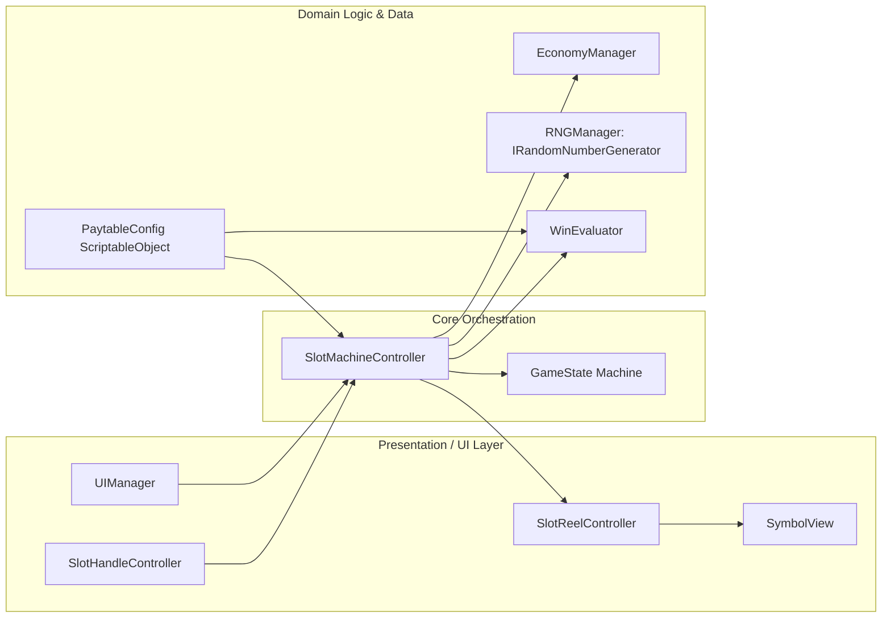

# Production-Grade 3x3 Video Slot Game

[-blue.svg?logo=unity)](https://unity.com/)
[](https://unity.com/srp/universal-render-pipeline)
[](https://unity.com/solutions/webgl)
[]()
[]()

> A casino-grade, responsive 3x3 video slot machine game developed in **Unity 6 (URP 2D)**. Built with clean modular OOP architecture, data-driven ScriptableObjects, realistic reel physics (anticipation pull-up, high-speed loop, and elastic overshoot bounce), an interactive mechanical lever arm, Wild & Scatter bonus modes, a "Double-or-Nothing" card gamble feature, and a zero-dependency runtime procedural audio synthesizer.

---

## 📑 Table of Contents
1. [Game Overview](#-game-overview)
2. [Instructions to Run](#-instructions-to-run)
   - [Play in Unity Editor](#1-play-in-unity-editor)
   - [Run Local WebGL Build](#2-run-local-webgl-build)
3. [Key Features & Game Feel ("Juice")](#-key-features--game-feel-juice)
4. [Bonus Features & Creativity](#-bonus-features--creativity)
5. [Architecture & Thought Process](#-architecture--thought-process)
6. [Winning Logic & Paytable Configuration](#-winning-logic--paytable-configuration)
7. [Folder & Project Organization](#-folder--project-organization)
8. [Automated Verification & Unit Tests](#-automated-verification--unit-tests)

---

## 📌 Game Overview

The game simulates a classic 3-reel, 3-row casino video slot machine. Players select their desired bet tier, spin the reels via the on-screen **SPIN** button, **Spacebar**, or by pulling the **Interactive Mechanical Lever**, and watch the reels decelerate in sequence with elastic bounce physics.

```text
+---------------+---------------+---------------+
|  Top Left     |   Top Mid     |   Top Right   |  <-- Payline 1 (Top Row)
+---------------+---------------+---------------+
|  Center Left  |  Center Mid   |  Center Right |  <-- Payline 2 (Center Row - Core Win Condition)
+---------------+---------------+---------------+
|  Bottom Left  |  Bottom Mid   |  Bottom Right |  <-- Payline 3 (Bottom Row)
+---------------+---------------+---------------+
     \                                     /
   Payline 4 (Diagonal \)             Payline 5 (Diagonal /)
```

---

## 🎮 Instructions to Run

### 1. Play in Unity Editor
1. Open **Unity Hub** and add/open the project folder:
   - **Unity Version**: `6000.3.9f1` (Unity 6) or later.
2. In the Project tab, navigate to `Assets/Scenes/SlotGameScene.unity` and double-click to open.
3. Press the **Play** button in the Unity Editor toolbar.
4. Interact using your mouse or keyboard:
   - **Click Spin Button** or press **Spacebar** to spin.
   - **Click & Drag Lever Handle** downward to trigger a mechanical pull.
   - **+/- Buttons** or **MAX BET** to adjust bet amount.
   - **AUTOSPIN** button to toggle automated spins.
   - **PAYTABLE** button to view symbol payouts and payline diagrams.

### 2. Run Local WebGL Build
A pre-compiled, fully self-contained WebGL build is included inside the `/Build/WebGL/` directory.

To run it locally via any HTTP server (e.g. Python, Node, or VSCode Live Server):

```bash
# Option A: Python 3
cd Build/WebGL
python3 -m http.server 8080

# Option B: Node http-server or npx serve
cd Build/WebGL
npx serve -l 8080
```
Open your browser to `http://localhost:8080` to play immediately!

---

## ✨ Key Features & Game Feel ("Juice")

### 1. Realistic Reel Physics & Motion
- **Anticipation Phase (`EaseInBack`)**: Upon spin initiation, reels subtly wind backwards and upward before dropping downward into high-speed rotation.
- **Staggered Stop Timing**: Reels stop sequentially from left to right (Reel 1 $\rightarrow$ Reel 2 $\rightarrow$ Reel 3) to build player anticipation.
- **Elastic Bounce Landing (`EaseOutBack`)**: Reels overshoot their target rest position slightly and spring back with mechanical inertia.
- **Anticipation Suspense Mode**: Landing 2 Scatter symbols on Reels 1 & 2 causes Reel 3 to spin longer with high-tension procedural audio pitch-shifting and pulsating symbol glows.

### 2. Visual Polish & Win Celebrations
- **Pulsating Payline Highlights**: Matching symbols glow and scale-pulse rhythmically along active paylines.
- **Tiered Win Celebrations**: Evaluates payout magnitude to trigger `NICE WIN!`, `BIG WIN!`, or `MEGA WIN!` celebrations with an animated credit roll-up counter.
- **Responsive Layout**: Designed on a responsive Canvas Scaler (1920x1080 reference) supporting 16:9, 18:9, and ultra-wide aspect ratios seamlessly.

### 3. Dynamic Audio & Procedural Waveform Synthesis
- Includes `AudioManager` with an onboard **Procedural Audio Synthesizer**.
- Generates real-time sine, square, triangle, and frequency-slide audio clips in memory without external audio file dependencies.
- Produces authentic button clicks, spinning whirs, reel mechanical ticks, stop thuds, win arpeggios, coin collections, and suspense stingers.

---

## 🎁 Bonus Features & Creativity

1. **Interactive Mechanical Lever**:
   - 2D/3D animated cabinet handle arm supporting click, drag, and release gestures with spring-loaded physical return and sound.
2. **Wild Joker Symbol**:
   - Substitutes for any regular paying symbol to complete winning lines.
3. **Scatter Free Spins Bonus**:
   - Landing 3 Star Scatters anywhere on the grid triggers **10 Free Spins** accompanied by a **2X Global Multiplier** and an active bonus HUD banner.
4. **"Double or Nothing" Gamble Mini-Game**:
   - After any standard win, players can risk their payout in a classic Red vs. Black card gamble. Correct guesses double the payout (up to 5 consecutive rounds).
5. **Auto-Spin Automation**:
   - Hands-free auto-spin mode with configurable pacing and automatic pause on feature triggers or insufficient balance.

---

## 🏗️ Architecture & Thought Process

The project adheres to Senior Game Developer standards: **SOLID principles**, **Model-View-Controller (MVC)** separation, **finite state machine**, and **zero-allocation mathematical easing**.



### Architectural Pillars:
1. **Separation of Concerns**:
   - Pure C# logic classes (`WinEvaluator`, `RNGManager`, `EconomyManager`) are completely free of `MonoBehaviour` and `UnityEngine.Object` dependencies, making them instantly testable in isolated CI/CD pipelines.
2. **Data-Driven Design (ScriptableObjects)**:
   - Symbol identities, icons, drop weights, and payline configurations are configured in `PaytableConfig` and `SymbolData` ScriptableObjects, allowing game designers to tune RTP (Return To Player) and payout tables without touching code.
3. **Deterministic & Auditable RNG**:
   - The RNG system interfaces through `IRandomNumberGenerator`, allowing deterministic seed injection for regression testing and regulatory audits.
4. **High Performance & Zero Allocations**:
   - Symbols use an object pooling recycle model inside `ReelStrip` instead of instantiate/destroy calls during gameplay.
   - Deceleration curves use pure mathematical functions (`EasingHelper`), avoiding GC pressure.

---

## 📊 Winning Logic & Paytable Configuration

The game evaluates 5 distinct paylines across the 3x3 reel matrix from left to right:
- **Payline 1**: Top Row `(0,0) - (1,0) - (2,0)`
- **Payline 2**: Center Row `(0,1) - (1,1) - (2,1)` *(Player wins when all 3 slots match)*
- **Payline 3**: Bottom Row `(0,2) - (1,2) - (2,2)`
- **Payline 4**: Diagonal Down `(0,0) - (1,1) - (2,2)`
- **Payline 5**: Diagonal Up `(0,2) - (1,1) - (2,0)`

### Symbol Hierarchy
| Symbol | Type | Base Payout (3-Match) | Base Payout (2-Match) | Drop Weight | Feature / Description |
| :--- | :--- | :---: | :---: | :---: | :--- |
| **Wild Joker** | Wild | **100x** | **10x** | 20 | Substitutes for any standard symbol |
| **Lucky Seven** | Standard | **50x** | **5x** | 40 | High-tier jackpot symbol |
| **Triple BAR** | Standard | **25x** | **3x** | 70 | Classic retro bar symbol |
| **Golden Bell** | Standard | **15x** | **2x** | 90 | Vintage casino bell |
| **Cherries** | Standard | **8x** | **1.5x** | 120 | Frequent low-tier fruit |
| **Star Scatter** | Scatter | Special | Special | 25 | 3 Scatters trigger **10 Free Spins (2X)** |

---

## 📁 Folder & Project Organization

The repository strictly follows standard Unity organization:

```text
Assets/
├── Animations/           # Slot machine lever animations & animator controller
├── Art/
│   └── Sprites/          # Sliced UI, Cabinet, Lever, and Symbol sprites
│       ├── Machine/
│       ├── Symbols/
│       └── UI/
├── Data/                 # ScriptableObjects (PaytableConfig & SymbolData)
│   └── Symbols/
├── Prefabs/              # Reusable prefabs (SymbolView, Popups)
├── Scenes/               # SlotGameScene.unity (Primary playable scene)
├── Scripts/
│   ├── Audio/            # AudioManager & SoundType procedural engine
│   ├── Core/             # SlotMachineController, GameState & EconomyManager
│   ├── Data/             # SymbolData, PaylineData, PaytableConfig
│   ├── Logic/            # WinEvaluator, RNGManager, IRandomNumberGenerator
│   ├── Reel/             # ReelStrip, SlotReelController, SymbolView
│   ├── UI/               # UIManager, PaytableUI, WinPopupUI, GambleUI, SlotHandle
│   └── Utils/            # EasingHelper equations
└── Tests/
    └── EditMode/         # Automated unit test suite (WinEvaluatorTests)

Build/
└── WebGL/                # Self-contained, runnable WebGL distribution
```

---

## 🧪 Automated Verification & Unit Tests

The test suite in `Assets/Tests/EditMode/WinEvaluatorTests.cs` runs via the Unity Test Framework (NUnit):
- `EvaluateGrid_ThreeSevensOnCenterLine_AwardsExactPayout`: Verifies exact base-bet multiplier matching on Payline 2.
- `EvaluateGrid_WildSubstitution_CompletesPayline`: Validates Wild substitution logic when bridging standard symbols.
- `EvaluateGrid_ThreeScatters_TriggersFreeSpins`: Ensures Scatter symbols trigger 10 Free Spins regardless of payline positioning.
- `EvaluateGrid_NoMatches_ReturnsZeroWin`: Asserts zero payout for non-matching combinations.
- `RNGManager_SeededExecution_ProducesIdenticalSequences`: Confirms PRNG deterministic reproducibility across seed configurations.

---

## 👨‍💻 Submission Notes

- **Commit History**: Progressively committed across distinct, meaningful milestones (`chore`, `feat(data)`, `feat(logic)`, `feat(audio)`, `feat(reel)`, `feat(core)`, `feat(ui)`, `feat(scene)`, `docs`).
- **Cleanliness**: External reference assets and temporary build caches are excluded via `.gitignore`.
